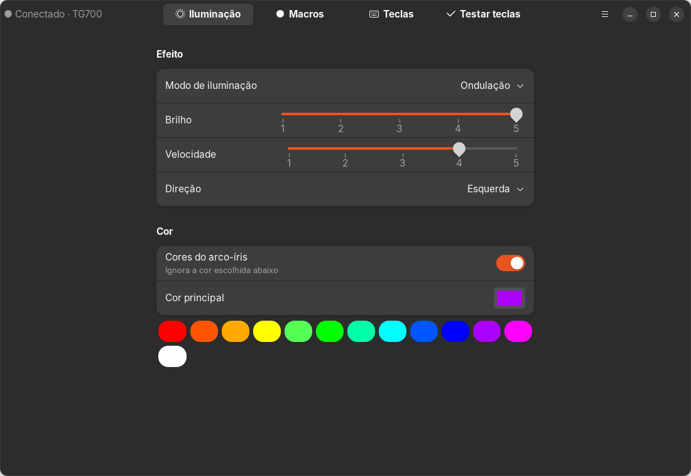
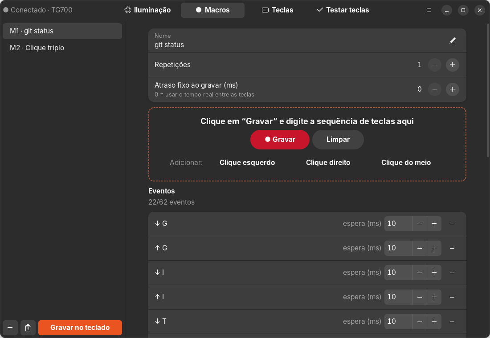
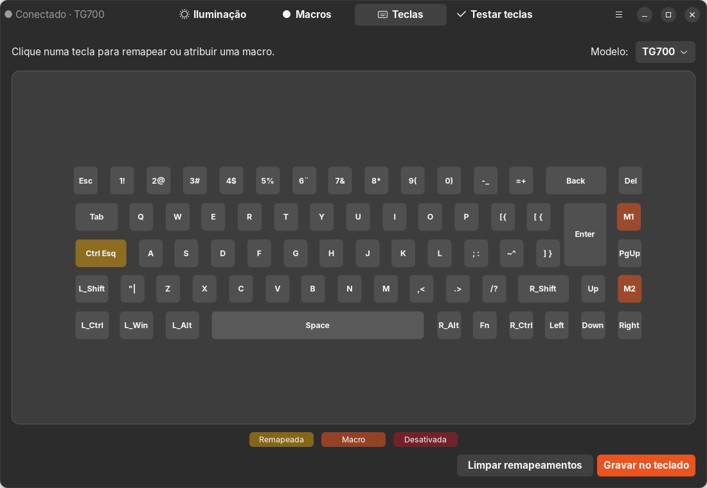
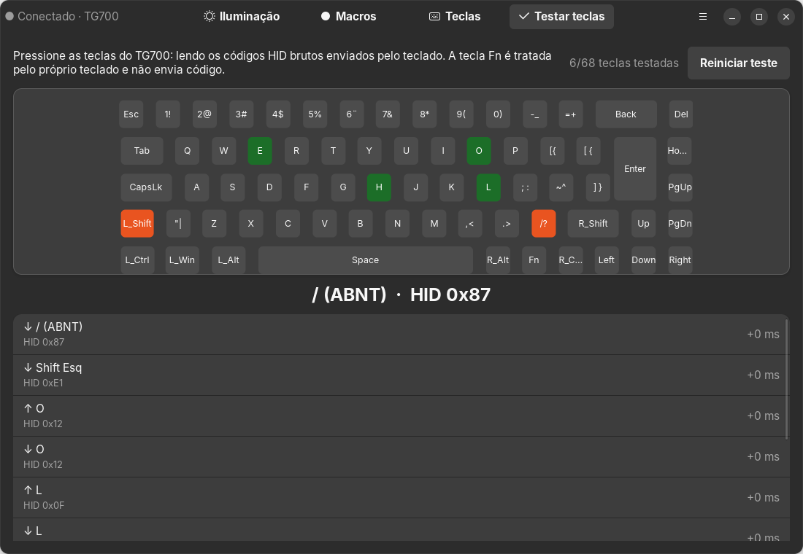
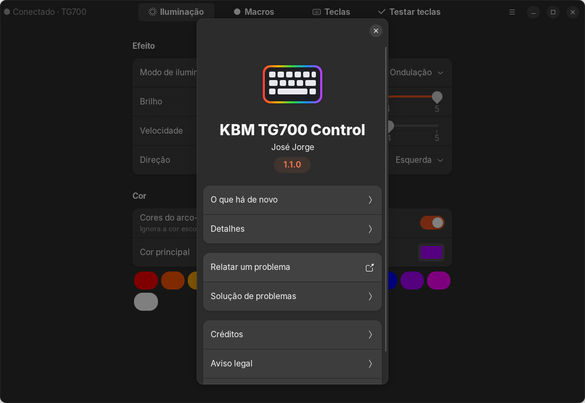

<p align="center">
  
</p>

<h1 align="center">KBM TG700 Control para Linux</h1>

<p align="center">
  <a href="https://github.com/JorgesOS7/kbm-tg700/actions/workflows/ci.yml"></a>
  <a href="https://github.com/JorgesOS7/kbm-tg700/releases/latest"></a>
  <a href="LICENSE"></a>
</p>

App nativo para Linux (GTK4 + libadwaita) que substitui o software oficial de Windows dos teclados
**KBM! GAMING TG600 / TG700** (USB `4a4c:e987`, chip JieLi).

> **Projeto independente e não oficial.** Sem afiliação com a KaBuM! ou com a fabricante do teclado.
> As marcas citadas pertencem aos seus donos e aparecem só para indicar compatibilidade.
> Use por sua conta e risco: em caso de problema, o menu **Restaurar padrão de fábrica** volta o
> teclado ao estado original.

## Recursos

- **Iluminação:** modo, cor, arco-íris, brilho, velocidade e direção, aplicados na hora
- **Macros:** até 10 macros com até 62 eventos (teclas e cliques de mouse, com atrasos)
- **Teclas:** remapear qualquer tecla, atribuir uma macro ou desativar
- **Testar teclas:** mostra o código HID bruto enviado por cada tecla (útil para achar defeitos)
- Tudo fica gravado na memória do teclado e funciona em qualquer computador, sem o app aberto

## Screenshots

| Iluminação | Macros |
|---|---|
|  |  |

| Teclas | Testar teclas |
|---|---|
|  |  |

<p align="center">
  
</p>

## Instalação (Ubuntu / Debian)

Baixe o `.deb` da última versão em [Releases](https://github.com/JorgesOS7/kbm-tg700/releases) e instale:

```bash
sudo apt install ./kbm-tg700_*_all.deb
```

Depois, reconecte o teclado e abra **KBM TG700 Control** no menu de aplicativos (ou rode `kbm-tg700`).

O pacote instala uma regra udev que dá acesso ao teclado para o usuário logado, sem precisar de root.

### Dependências

Python 3.10+, PyGObject, GTK 4 e libadwaita 1.4+. No Ubuntu 24.04 / Debian 13:

```bash
sudo apt install python3-gi gir1.2-gtk-4.0 gir1.2-adw-1
```

## Rodar a partir do código

```bash
git clone https://github.com/JorgesOS7/kbm-tg700.git
cd kbm-tg700
sudo cp packaging/70-kbm-tg700.rules /etc/udev/rules.d/
sudo udevadm control --reload-rules && sudo udevadm trigger
python3 -m kbm_tg700
```

Gerar o pacote: `./build-deb.sh` (o `.deb` sai em `dist/`).

## Modelos

| Modelo | Status |
|---|---|
| TG700 | Testado: iluminação, macros, remapeamento e teste de teclas |
| TG600 / TG600W | Layout incluído, não testado em hardware. Relatos são bem-vindos |

## Limitações conhecidas

- Só a camada normal do teclado é editada; a camada Fn ainda não.
- Os modos "Personalizado" (cor por tecla) e "Ritmo musical" ainda não têm controles próprios.
- Teclas de mídia e movimento de mouse não podem ser usados em macros.

## Como funciona

O protocolo USB foi descoberto por engenharia reversa do software oficial, para fins de
interoperabilidade. Os detalhes estão em [docs/PROTOCOL.md](docs/PROTOCOL.md). Nenhum arquivo do
software original (executáveis, DLLs, imagens) faz parte deste repositório.

## Contribuir

Veja [CONTRIBUTING.md](CONTRIBUTING.md).

## Licença

[MIT](LICENSE) © José Jorge
